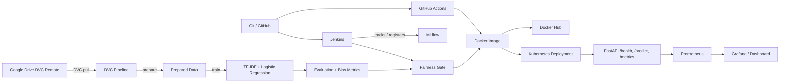

# Civil Comments Toxicity Classification — End-to-End MLOps Platform

This project builds, evaluates, versions, serves, monitors, and deploys a binary toxicity classifier for online comments. It uses the Jigsaw Civil Comments dataset and demonstrates an end-to-end MLOps workflow with reproducible data pipelines, automated testing, CI/CD, fairness evaluation, containerization, orchestration, and monitoring.

Repository: <https://github.com/saikatsam11/MLOps-Midterm>

> Content warning: The dataset and model can contain or predict abusive and offensive language. Use the project only for educational and research purposes.

---

## 1. Problem statement and aim

### Problem

Online platforms receive large volumes of user-generated text. A practical toxicity system must not only achieve good overall classification performance, but also avoid unequal error rates across identity-related groups.

### Aim

Build a binary classifier that predicts whether a comment is toxic and provides:

- Reproducible training and evaluation
- Overall quality metrics
- Identity-subgroup bias metrics
- Automated tests
- A fairness gate for candidate models
- A REST API for inference
- Docker packaging and Kubernetes deployment
- CI/CD through GitHub Actions and Jenkins
- MLflow experiment/model registry support
- Prometheus metrics and Grafana-compatible monitoring

### Dataset

The project uses the Jigsaw Civil Comments dataset. The source file is `train.csv` and must contain the following important columns:

| Column | Purpose |
|---|---|
| `comment_text` | Input comment text |
| `target` | Continuous toxicity score |
| `toxic` | Binary label created when `target >= 0.5` |
| Identity columns | Boolean or continuous identity indicators used for bias evaluation |

DVC tracks `train.csv`. The data is intentionally not committed directly to Git because the source is large and should be managed separately through the configured Google Drive DVC remote.

---

## 2. Main results

The committed standard-model outputs are stored in:

- `metrics/metrics.json` — overall validation metrics and threshold sweep
- `metrics/bias.json` — overall and identity-subgroup bias metrics
- `artifacts/model_metadata.json` — model configuration and best threshold

Observed results in the checked-in metrics include:

- Overall ROC-AUC: approximately `0.9288` at the default threshold
- Accuracy at threshold `0.5`: approximately `0.9349`
- Precision: approximately `0.5733`
- Recall: approximately `0.6467`
- F1: approximately `0.6078`
- Identity hold-out size: `100,000` rows
- Overall bias-evaluation AUC: approximately `0.9047`
- Final bias-aware score: approximately `0.8624`

Re-running the pipeline can change these numbers if `params.yaml`, the model version, the preprocessing, or the source data changes. Always use the generated JSON files as the authoritative results.

Main quantitative measures:

- Accuracy
- Precision
- Recall
- F1
- ROC-AUC
- Average precision
- Subgroup AUC
- BPSN AUC (false-positive behavior on identity-related negative comments)
- BNSP AUC (false-negative behavior on identity-related positive comments)
- Weighted bias-aware final score

### Generate or refresh results

```bash
python src/prepare.py
python src/train.py
python src/evaluate.py
python src/bias_eval.py
```

Or reproduce every DVC stage with:

```bash
dvc repro
```

---

## 3. Tools and architecture

### Demonstrated tools

1. **Git and GitHub** — source control and pull-request code review
2. **DVC** — versioned data and reproducible pipeline orchestration
3. **Python, pandas, and scikit-learn** — data preparation, training, and evaluation
4. **MLflow** — experiment tracking and model registry support in Jenkins
5. **pytest** — unit, API, data, fairness, and registry tests
6. **GitHub Actions and Jenkins** — CI/CD automation
7. **Docker and Docker Hub** — application containerization and image distribution
8. **Kubernetes, Prometheus, and Grafana-compatible monitoring** — deployment, scraping, and dashboards



### Repository layout

```text
.
├── .github/workflows/dvc_pipeline.yml # GitHub Actions CI/CD workflow
├── .dvc/config                         # DVC remote configuration
├── artifacts/                          # Model and tokenizer artifacts
├── data/processed/                     # DVC-generated prepared data
├── docker/Dockerfile.api               # API image definition
├── jenkins/                            # Jenkins and MLflow Docker setup
│   ├── docker-compose.yml
│   ├── Dockerfile
│   └── Dockerfile.mlflow
├── kubernetes/                         # Deployment, Service, and ServiceMonitor
├── metrics/                            # Evaluation and bias JSON outputs
├── monitoring/prometheus.yml           # Prometheus scrape configuration
├── scripts/                            # Fairness gate and registry utilities
├── src/                                # Data, training, evaluation, MLflow code
├── tests/                              # Automated tests
├── app.py                              # FastAPI application
├── dvc.yaml                            # DVC pipeline definition
├── params.yaml                         # Data, feature, model, and gate parameters
├── requirements-train.txt              # Training/test dependencies
├── requirements-api.txt                # API dependencies
├── Jenkinsfile                         # Jenkins pipeline
└── train.csv.dvc                       # DVC pointer for the source dataset
```

---

## 4. Prerequisites

### Required software

| Tool | Minimum/known version | Purpose |
|---|---|---|
| Git | Recent | Clone and version source |
| Python | 3.12 | Training, API, and tests |
| DVC with Google Drive support | Recent | Dataset management |
| Docker Engine or Docker Desktop | Recent | Containers and Compose |
| Docker Compose v2 | Recent | Jenkins and MLflow |
| kubectl | Recent | Kubernetes deployment |
| Kubernetes cluster | Kind, Minikube, k3s, or equivalent | Deployment |
| Jenkins optional | Container provided | Continuous delivery demo |

### For GitHub Actions

The CI workflow uses these secrets when their corresponding features are enabled:

| Secret | Required for |
|---|---|
| `GDRIVE_CREDENTIALS_DATA` | Downloading DVC data from Google Drive |
| `DOCKERHUB_USERNAME` | Publishing the API image |
| `DOCKERHUB_TOKEN` | Authenticating to Docker Hub |

GitHub Actions does **not** need MLflow registry credentials for the fairness-gate step because the current workflow runs the gate locally with no production registry baseline.

No personal access tokens, private keys, or service-account JSON files should be committed to the repository.

---

## 5. Local installation

### Linux/macOS

```bash
git clone https://github.com/saikatsam11/MLOps-Midterm.git
cd MLOps-Midterm

python3.12 -m venv .venv
source .venv/bin/activate
python -m pip install --upgrade pip
python -m pip install -r requirements-train.txt
python -m pip install -r requirements-api.txt
python -m pip install "dvc[gdrive]" pyarrow
```

### Windows PowerShell

```powershell
git clone https://github.com/saikatsam11/MLOps-Midterm.git
cd MLOps-Midterm

py -3.12 -m venv .venv
.venv\Scripts\Activate.ps1
python -m pip install --upgrade pip
python -m pip install -r requirements-train.txt
python -m pip install -r requirements-api.txt
python -m pip install "dvc[gdrive]" pyarrow
```

If PowerShell blocks activation, run this only in the current terminal session:

```powershell
Set-ExecutionPolicy -Scope Process -ExecutionPolicy Bypass
```

### Verify the installation

```bash
python --version
python -m pip check
pytest -q
```

The full clean-environment test suite should pass before running the training pipeline.

---

## 6. Get the dataset through DVC

The DVC remote is configured in `.dvc/config` to use the Google Drive folder referenced by this project.

The reviewer must have access to that Google Drive folder and must authenticate with a Google account authorized for it.

### Interactive local setup

```bash
dvc pull
```

Follow the browser authorization window. On Linux/macOS, OAuth tokens are normally cached locally; do not upload those files.

After a successful pull:

```bash
ls -lh train.csv train.csv.dvc
dvc status
```

### Google service-account setup for CI

1. Open the Google Cloud project that owns or administers the service account.
2. Create or use a service account that can read the DVC Drive folder.
3. Share the Drive folder with the service account email.
4. Download the service-account JSON.
5. In GitHub, open `Settings > Secrets and variables > Actions`.
6. Create `GDRIVE_CREDENTIALS_DATA` and paste the complete JSON content as its value.

The GitHub workflow writes the secret to `$RUNNER_TEMP/gdrive-service-account.json`, configures DVC locally, and removes the runner environment after the job finishes.

---

## 7. Reproduce the training pipeline

Configuration is stored in `params.yaml`. Key sections include:

- `data` — input columns, row limits, splits, identity columns
- `features` — word and character TF-IDF settings
- `model` — Logistic Regression settings
- `candidate` — standard, imbalanced, or reweighted candidate strategies
- `evaluation` — ROC and F1 threshold configuration
- `bias` — bias power mean and component weights
- `gate` — regression tolerances

Run all stages:

```bash
dvc repro
```

### DVC stages

| Stage | Input | Output |
|---|---|---|
| `prepare` | `train.csv`, `params.yaml`, `src/prepare.py` | Processed train/validation CSV files and identity hold-out parquet |
| `train` | Processed train data | Word TF-IDF, character TF-IDF, and Logistic Regression artifacts |
| `evaluate` | Validation data and model artifacts | Validation metrics and best threshold |
| `bias_eval` | Identity hold-out and model artifacts | Overall and subgroup bias metrics |

Check pipeline status:

```bash
dvc status
dvc dag
```

Metrics can be shown with:

```bash
dvc metrics show
```

---

## 8. Run the API locally

Make sure the model artifacts exist in `artifacts/`.

```bash
uvicorn app:app --host 0.0.0.0 --port 8000 --reload
```

Open:

- Swagger UI: <http://localhost:8000/docs>
- Health: <http://localhost:8000/health>
- Metrics: <http://localhost:8000/metrics>

### Example prediction

```bash
curl -X POST http://localhost:8000/predict \
  -H 'Content-Type: application/json' \
  -d '{"comment":"I really like this product"}'
```

Expected response shape:

```json
{
  "prediction": "non-toxic",
  "is_toxic": false,
  "toxicity_probability": 0.123456,
  "threshold": 0.5
}
```

The exact probability depends on the trained model and threshold configuration.

---

## 9. Run API tests

```bash
pytest -q tests/test_api.py
```

Or run every test:

```bash
pytest -q
```

The API tests verify:

- Application lifespan loads model artifacts
- `/health` reports the model state
- `/predict` accepts a valid comment and returns a response
- `/metrics` exposes Prometheus data

---

## 10. Docker

Build the image from the repository root:

```bash
docker build -f docker/Dockerfile.api -t toxicity-api:local .
```

Run it:

```bash
docker run --rm -p 8000:8000 toxicity-api:local
```

Test it:

```bash
curl http://localhost:8000/health
curl http://localhost:8000/metrics
```

The image installs both training and API dependencies and copies the model artifacts. The model is therefore served directly from the image in the current setup.

### Docker Hub publish

```bash
docker login
docker tag toxicity-api:local <dockerhub-username>/toxicity-api:latest
docker push <dockerhub-username>/toxicity-api:latest
```

GitHub Actions can perform this automatically when `DOCKERHUB_USERNAME` and `DOCKERHUB_TOKEN` are configured.

---

## 11. Kubernetes deployment

The deployment manifests are in `kubernetes/`.

Update the image in `kubernetes/toxicity-api.yaml` if the image repository is different, then deploy:

```bash
kubectl apply -f kubernetes/toxicity-api.yaml
kubectl rollout status deployment/toxicity-api
kubectl get pods,svc
```

The service uses NodePort and exposes the API on port `30081`:

```text
http://<cluster-node-ip>:30081
```

Useful checks:

```bash
kubectl port-forward svc/toxicity-api-service 8000:8000
curl http://localhost:8000/health
kubectl logs deploy/toxicity-api
```

The `ServiceMonitor` manifest requires the Prometheus Operator to be installed in the cluster:

```bash
kubectl apply -f kubernetes/toxicity-api-servicemonitor.yaml
kubectl get servicemonitor
```

---

## 12. Prometheus and Grafana

The FastAPI application exposes Prometheus metrics at `/metrics`, including:

- `toxicity_api_requests_total`
- `toxicity_api_request_duration_seconds`
- `toxicity_predictions_total`

For a standalone Prometheus configuration, the repository provides `monitoring/prometheus.yml`. Its target is `toxicity-api:8000`, which is suitable when Prometheus and the API share a Docker network or Kubernetes DNS-style service setup.

An optional local stack can use Grafana and Prometheus with Docker Compose; the MLOps container demonstration also provides a Prometheus-compatible scrape target through the Kubernetes ServiceMonitor.

Example Grafana panels:

- Request rate by HTTP status
- Request latency histogram
- Prediction counts by toxic/non-toxic label
- API pod availability
- `/health` endpoint status

Suggested Grafana queries:

```promql
rate(toxicity_api_requests_total[5m])
```

```promql
histogram_quantile(0.95, rate(toxicity_api_request_duration_seconds_bucket[5m]))
```

```promql
sum by (prediction) (toxicity_predictions_total)
```

---

## 13. Jenkins and MLflow reproduction

The Jenkins/MLflow local stack is optional for the GitHub Actions workflow but demonstrates continuous delivery, registry, and candidate promotion.

### Start Jenkins and MLflow

From the repository root:

```bash
docker compose -f jenkins/docker-compose.yml up -d --build
```

Open:

- Jenkins: <http://localhost:8080>
- MLflow: <http://localhost:5000>

Get the initial Jenkins password:

```bash
docker exec jenkins-toxicity cat /var/jenkins_home/secrets/initialAdminPassword
```

Complete Jenkins setup, install suggested plugins, and create a pipeline job using the repository `Jenkinsfile`.

### Jenkins pipeline stages

1. Checkout repository
2. Create a Python environment
3. Run unit tests
4. Download DVC data or use a mounted dataset
5. Reproduce the DVC pipeline
6. Log metrics and register the model in MLflow
7. Fetch the production baseline when one exists
8. Run the fairness gate
9. Reject or promote the candidate
10. Optionally build and deploy the Docker image

The Jenkins pipeline supports these parameters:

- `DATA_SOURCE`: `dvc` or `mounted`
- `CANDIDATE`: `standard`, `imbalanced`, or `reweighted`
- `RUN_LABEL`: custom MLflow run name
- `MAX_ROWS`: optional row-count override
- `DEPLOY`: whether to build/deploy Kubernetes
- `IMAGE`: deployment image name

To use DVC inside Jenkins, configure a Jenkins Secret file credential named:

```text
gdrive-user-credentials
```

The Jenkinsfile reads it as `GDRIVE_CREDS` and converts it into the `GDRIVE_CREDENTIALS_DATA` environment variable used by DVC.

---

## 14. GitHub Actions CI/CD

The workflow is `.github/workflows/dvc_pipeline.yml`.

It triggers for:

- Pushes to `main`
- Pull requests targeting `main`
- Manual workflow dispatch

### CI stages

1. Checkout source code
2. Create a Python 3.12 training environment
3. Create a separate DVC environment
4. Validate the Google service-account secret
5. Configure DVC authentication
6. Pull data through DVC
7. Reproduce the DVC pipeline
8. Run the complete pytest suite
9. Run the local fairness gate
10. Check the DVC working tree
11. Upload metrics and model artifacts

### Required GitHub Actions secrets

Add these under `Settings > Secrets and variables > Actions`:

```text
GDRIVE_CREDENTIALS_DATA
DOCKERHUB_USERNAME
DOCKERHUB_TOKEN
```

`GDRIVE_CREDENTIALS_DATA` is required by the DVC pull step. Docker secrets are only required for publishing from the `publish` job on pushes to `main`.

Pull requests normally run the CI job but do not publish a Docker image.

### Re-run manually

1. Open the repository on GitHub.
2. Select **Actions**.
3. Select **MLOps CI/CD**.
4. Select **Run workflow**.
5. Choose `main` and run it.

---

## 15. Fairness evaluation and gate

The bias evaluation script separates a fixed identity-labelled hold-out before training. This prevents identity hold-out rows from appearing in training or validation.

The fairness gate compares:

- Overall ROC-AUC
- Final bias-aware score
- Subgroup AUC
- BPSN AUC

Current tolerances in `params.yaml` are:

```yaml
gate:
  overall_auc_tolerance: 0.002
  final_score_tolerance: 0.0
  subgroup_auc_tolerance: 0.01
  bpsn_auc_tolerance: 0.01
```

Run locally without a production baseline:

```bash
python scripts/fairness_gate.py --candidate metrics/bias.json
```

When no production baseline is supplied, the project treats the candidate as the first model and passes the gate.

For a production comparison, provide a baseline JSON:

```bash
python scripts/fairness_gate.py \
  --candidate metrics/bias.json \
  --production metrics/prod_bias.json
```

The gate writes `metrics/gate_report.json`.

---

## 16. Candidate strategies

Candidate behavior is controlled by `params.yaml`:

### Standard

```yaml
candidate:
  strategy: standard
```

Uses the normal training sample and unmodified sample weights.

### Imbalanced

Drops a fraction of non-toxic comments that mention selected protected identities. This can demonstrate how loss of subgroup-negative examples affects false positives.

### Reweighted

Assigns larger training weights to identity-related non-toxic comments. This can demonstrate a candidate intervention for subgroup behavior.

Set a strategy locally or temporarily:

```bash
python -c "import yaml; p=yaml.safe_load(open('params.yaml')); p['candidate']['strategy']='reweighted'; yaml.safe_dump(p,open('params.yaml','w'),sort_keys=False)"
dvc repro
```

Restore the standard strategy before committing reproducible results:

```bash
python -c "import yaml; p=yaml.safe_load(open('params.yaml')); p['candidate']['strategy']='standard'; yaml.safe_dump(p,open('params.yaml','w'),sort_keys=False)"
```

---

## 17. Challenges and fixes

This project encountered several real integration issues during development:

### 1. Large dataset management

**Challenge:** The source CSV is too large to manage reliably only as source code.

**Solution:** DVC tracks the dataset pointer and caches/pulls data from Google Drive.

### 2. Google Drive authentication

**Challenge:** Local OAuth and GitHub-hosted service-account authentication use different workflows.

**Solution:** Local environments use browser authorization; GitHub Actions uses `GDRIVE_CREDENTIALS_DATA`. Credentials remain outside Git.

### 3. PyOpenSSL incompatibility

**Challenge:** Newer `pyOpenSSL`/`cryptography` combinations produced `GEN_EMAIL` and `crypto.sign` failures in older Google Drive authentication libraries.

**Solution:** A tested Python 3.12-compatible stack is pinned in the requirements and workflow:

```text
pyOpenSSL==24.2.1
cryptography==43.0.3
```

### 4. FastAPI TestClient dependency mismatch

**Challenge:** Unpinned future package resolution installed an incompatible Starlette release that looked for `httpx2` instead of standard `httpx`.

**Solution:** API dependencies pin compatible versions:

```text
fastapi==0.115.12
starlette==0.46.2
httpx==0.28.1
```

### 5. MLflow and SQLAlchemy mismatch

**Challenge:** MLflow encountered SQLAlchemy internals that were unavailable in SQLAlchemy 2.1.

**Solution:** SQLAlchemy is constrained below 2.1 and MLflow is pinned to `3.17.2`.

### 6. API request contract mismatch

**Challenge:** The initial prediction test sent `text`, while the FastAPI model requires `comment`.

**Solution:** Tests now use `{"comment":"..."}` and lifecycle fixtures enter FastAPI lifespan so artifacts are loaded.

### 7. Model availability during testing

**Challenge:** The `/health` endpoint can correctly return `503` when the artifacts directory is not present.

**Solution:** Run tests only after DVC has pulled model artifacts, or run DVC reproduction first.

### 8. MLflow service visibility

**Challenge:** `127.0.0.1:5000` inside GitHub Actions refers to the runner, not a developer's local MLflow server.

**Solution:** The current GitHub workflow removed registry-dependent baseline and promotion steps. MLflow remains available in the separate Jenkins environment.

---

## 18. Demo and presentation evidence

The professor requested sample-data, architecture, demo, challenges, and results screenshots. The repository contains reproducible outputs that can be used for slides:

### Recommended screenshots

1. Sample rows from `train.csv`, with comments and toxicity identity fields
2. `dvc dag` output
3. Training logs from `dvc repro`
4. `metrics/metrics.json` and threshold-sweep graph
5. `metrics/bias.json` and subgroup-AUC table
6. GitHub Actions successful CI run
7. Jenkins successful pipeline and MLflow experiment/model page
8. Docker image in Docker Hub or local Docker output
9. `kubectl get pods,svc` and rollout output
10. Swagger `/docs` or Postman/curl prediction response
11. Prometheus metrics and Grafana dashboard

No screenshot is needed inside the repository for reproduction. Take screenshots from the commands below for the presentation.

---

## 19. Cleanup

Stop the Jenkins and MLflow containers:

```bash
docker compose -f jenkins/docker-compose.yml down
```

Remove containers, images, and persistent volumes:

```bash
docker compose -f jenkins/docker-compose.yml down -v
```

Remove a local Kubernetes deployment:

```bash
kubectl delete -f kubernetes/toxicity-api.yaml
kubectl delete -f kubernetes/toxicity-api-servicemonitor.yaml
```

Remove Python environments locally:

```bash
rm -rf .venv
```

On Windows PowerShell:

```powershell
Remove-Item -Recurse -Force .venv
```

---

## 20. Troubleshooting

### `dvc pull` fails or uses the wrong account

- Confirm the Drive folder is shared with the account/service account.
- Remove obsolete local DVC credentials and authorize again if necessary.
- Never commit OAuth or service-account credentials.
- Confirm `.dvc/config` contains the expected remote URL.

### `AttributeError: module 'OpenSSL.crypto' has no attribute 'sign'`

Install the pinned versions listed in this README and recreate the DVC environment:

```bash
rm -rf .dvc-venv
python3.12 -m venv .dvc-venv
.dvc-venv/bin/python -m pip install --upgrade pip
.dvc-venv/bin/pip install "dvc[gdrive]" "pyOpenSSL==24.2.1" "cryptography==43.0.3"
```

### FastAPI TestClient reports missing `httpx2`

Reinstall the API requirements and ensure HTTPX is installed:

```bash
python -m pip install -r requirements-api.txt
python -m pip check
python -c "from fastapi.testclient import TestClient; print('OK')"
```

### `/health` returns `503`

Run `dvc repro` and verify these files exist:

```text
artifacts/word_tfidf_vectorizer.joblib
artifacts/char_tfidf_vectorizer.joblib
artifacts/toxicity_logistic_regression.joblib
artifacts/model_metadata.json
```

### `/predict` returns `422`

Send the required `comment` field:

```bash
curl -X POST http://localhost:8000/predict \
  -H 'Content-Type: application/json' \
  -d '{"comment":"This is a test comment"}'
```

### Kubernetes image does not update

Set `imagePullPolicy` or push and update the image tag explicitly:

```bash
kubectl set image deployment/toxicity-api api=<dockerhub-user>/toxicity-api:<new-tag>
kubectl rollout status deployment/toxicity-api
```

### Jenkins cannot access Google Drive

Use a mounted test dataset for demonstration, or add the DVC OAuth credential as the Jenkins Secret file credential `gdrive-user-credentials`.

---

## 21. License and attribution

This repository is intended for an academic MLOps project and includes third-party tools, libraries, and dataset content. Review the Jigsaw Civil Comments dataset license and use restrictions before publishing derived data or models. Repositories and Docker images may contain offensive language used for model training and evaluation.

## 22. Summary workflow

For the shortest reproducible path on Linux/macOS:

```bash
git clone https://github.com/saikatsam11/MLOps-Midterm.git
cd MLOps-Midterm
python3.12 -m venv .venv
source .venv/bin/activate
python -m pip install -r requirements-train.txt
python -m pip install -r requirements-api.txt
python -m pip install "dvc[gdrive]" pyarrow
dvc pull
dvc repro
pytest -q
uvicorn app:app --host 0.0.0.0 --port 8000
```

The API will be available at <http://localhost:8000/docs>.